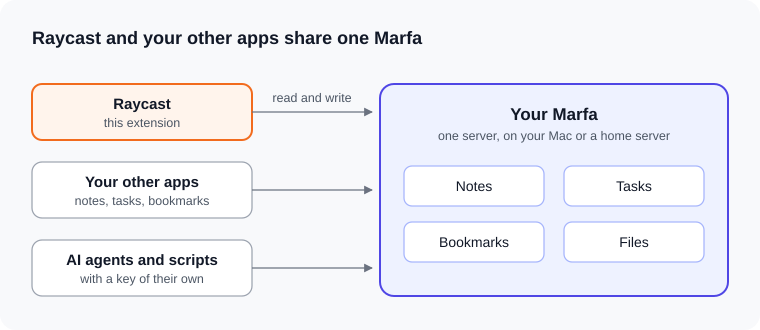
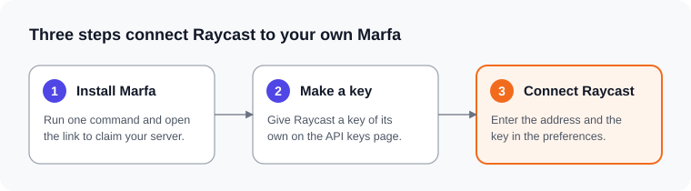

# Marfa for Raycast

Capture to your own Marfa from anywhere on your Mac, and browse what all your apps keep there.

## What is Marfa?

Marfa is a shared data layer for your apps, and you run it yourself. Your notes, tasks, bookmarks, and files live in one server that you own, as typed items. Every app you allow reads and writes the same items, so your data stays put when you change apps.



The extension keeps no copy of your data, so every command needs your server to be reachable. Marfa is early software, so expect breaking changes until version 1.0.

## How you might use this extension

- **As a client for the Marfa you already run.** Raycast becomes one more way into your items. Search them, capture to them, and edit them without opening another app.
- **As your notes in Raycast.** If you only want somewhere to put notes, Marfa is the store behind them. Your notes stay on your own machine, and any app you add later can read them.

## Set up

You need Raycast on a Mac, and Docker or OrbStack to run the server.



1. **Install Marfa.** In Terminal, run:

   ```sh
   brew install withmarfa/tap/marfa
   marfa server install
   ```

   Open the link the command prints, and choose an email and password. That makes you the owner of your server.

2. **Make a key for Raycast.** In your server's web page, open **API keys** and choose **Create key**. Name it `Raycast` and give it the source `raycast`. Turn on read and write for all types, tags, and edges. To let Raycast delete items for good, also allow permanent deletes. Copy the key. The page shows it once.

3. **Connect Raycast.** Open any Marfa command, then enter the **Server URL** (`http://localhost:8600` if you installed it on this Mac, unless the install printed another port) and the **API Key**.

To reach your server from other devices, see [Deploy](https://docs.marfa.so/guides/deploy).

## Commands

| Command       | What it does                                                                                                  |
| ------------- | ------------------------------------------------------------------------------------------------------------- |
| Browse        | Search your items. Open, edit, tag, archive, reply to, annotate, trash, or delete them.                       |
| Create Item   | Create a note, or an item of any type your server holds, in a form built from the type.                       |
| Quick Capture | Capture the text you have selected, or your clipboard, in a form. A copied file or image becomes a file item. |
| Type Registry | See every type your server holds and the fields each one declares.                                            |
| Manage Keys   | List, make, change, and revoke API keys. Needs a key that holds `keys.mint` or `keys.manage`.                 |
| Status        | Check your server, its contract, and your API key.                                                            |

Raycast AI can search, list, and capture items too. Mention `@marfa`.

## Preferences

| Preference           | Description                                                                             |
| -------------------- | --------------------------------------------------------------------------------------- |
| Server URL           | Where your Marfa server answers.                                                        |
| API Key              | The key you made for Raycast.                                                           |
| Default Capture Type | The type that Create Item and Quick Capture start on. The default is `core.note`.       |
| Default Tier         | Where captures land: the library keeps what you chose to keep, the feed holds the rest. |
| Selected Text        | Quick Capture starts from the selected text when there is some. On by default.          |
| Default Tags         | Tags that every capture starts with, separated by commas.                               |

## License

MIT. See [LICENSE](LICENSE). To work on the extension, see [AGENTS.md](AGENTS.md).
